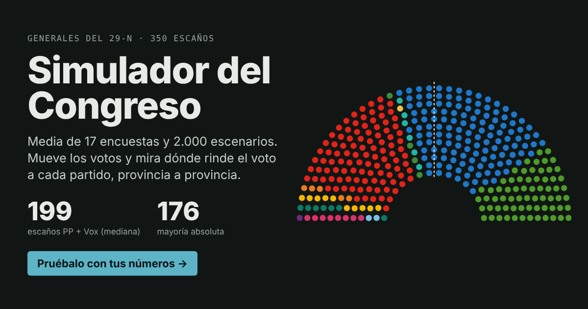

# Voto útil a la derecha · Generales 29-N 2026

Simulador de escaños del Congreso de los Diputados para las elecciones generales del 29 de noviembre de 2026. Parte de una media bayesiana de encuestas y permite mover los supuestos para ver cómo cambia el reparto, nacional y por provincia, y dónde rinde más el voto a Vox o al PP para el bloque PP+Vox.

**[Abrir el simulador](https://votoutilderecha.github.io/)**



## Qué hace

- **Reparto D'Hondt** en las 52 circunscripciones, con el umbral del 3% sobre voto válido (incluye el voto en blanco) y los escaños del Real Decreto 806/2026: Madrid 38 y Cádiz 8.
- **Simulación Monte Carlo** en el navegador (6.000 escenarios por defecto) con:
  - un error común de bloque derecha/izquierda y un error propio de cada partido;
  - ruido regional y provincial;
  - swing proporcional desde el perfil territorial de 2023.
- **Voto útil:** en cada provincia, la probabilidad de que mover voto de Vox a PP, o de PP a Vox, haga ganar un escaño al bloque PP+Vox, y cuántos votos hacen falta en el escenario central.
- **Bloques:** distribución de escaños y de voto para derecha, izquierda y otros.

## Validación

- El motor reproduce los 350 escaños oficiales del 23-J (definitivos, con CERA) provincia por provincia, sin ninguna discrepancia (`model/validate.py`).
- El motor JavaScript de la página y el de Python dan el mismo resultado dentro del error de simulación (`model/test_js.js`).

## Datos y supuestos

| Elemento | Fuente o supuesto |
|---|---|
| Base 2023 | Resultados definitivos por circunscripción (Wikipedia, páginas de cada circunscripción) |
| Podemos y SALF | Perfil por comunidad de las europeas de 2024 |
| Encuestas | 17 encuestas publicadas del 7 de septiembre al 17 de octubre de 2026, la última de cada empresa, ponderadas por muestra y antigüedad (vida media de 21 días); prior centrado en el 23-J |
| Error del día de la elección | Calibrado con 2016, abril 2019, noviembre 2019 y 2023: unos 2,2 pts de error de bloque al final de la campaña y unos 2,9 pts a 43 días (`model/hist_horizon.py`) |
| Candidaturas 29-N | Podemos apoya a ERC en Cataluña; Compromís-Front Valencià (con Podemos y EUPV); Unidad del Pueblo Canario (FA, Podemos y NC-BC); UPN en coalición con el PP; Aliança Catalana no se presenta; Coalición Existe en Aragón |

**Supuestos más débiles:**
- el reparto interno del espacio Sumar/Compromís en la Comunidad Valenciana;
- el perfil uniforme de Adelante Andalucía;
- la participación por provincia, fija en la de 2023.

**Lo que el modelo no hace:**
- no modela efectos de casa por encuestadora;
- no modela cambios de participación;
- no recoge errores de encuesta distintos por territorio, salvo como ruido regional.

## Estructura

```
index.html           página del simulador (autocontenida)
data/                datos de entrada y salidas intermedias
model/engine.py      motor D'Hondt
model/parse*.py      lectura de resultados 2023, europeas 2024 y encuestas (necesitan las páginas HTML en raw/)
model/polls_model.py agregación bayesiana de encuestas
model/build_base.py  cuotas base por provincia y ajustes por candidaturas
model/build_page.py  genera index.html a partir de model/template.html
model/validate.py    validación contra 2023
model/hist_*.py      error histórico de las encuestas
```

Para regenerar la página:

```
python3 model/build_base.py && python3 model/polls_model.py && SITE_URL=https://votoutilderecha.github.io/ python3 model/build_page.py
```

## Fuentes

- Wikipedia: *Results breakdown of the 2023 Spanish general election (Congress)* y las páginas de cada circunscripción
- Wikipedia: *Results breakdown of the 2024 European Parliament election in Spain*
- Wikipedia: *Opinion polling for the next Spanish general election* y las páginas de encuestas de 2016, 2019 (abril y noviembre) y 2023
- BOE-A-2026-20742, Real Decreto 806/2026 de convocatoria
- Prensa sobre las candidaturas: Infobae, Mundiario, El Plural

Herramienta de análisis, no es un pronóstico oficial. Datos consultados el 22 de octubre de 2026.
